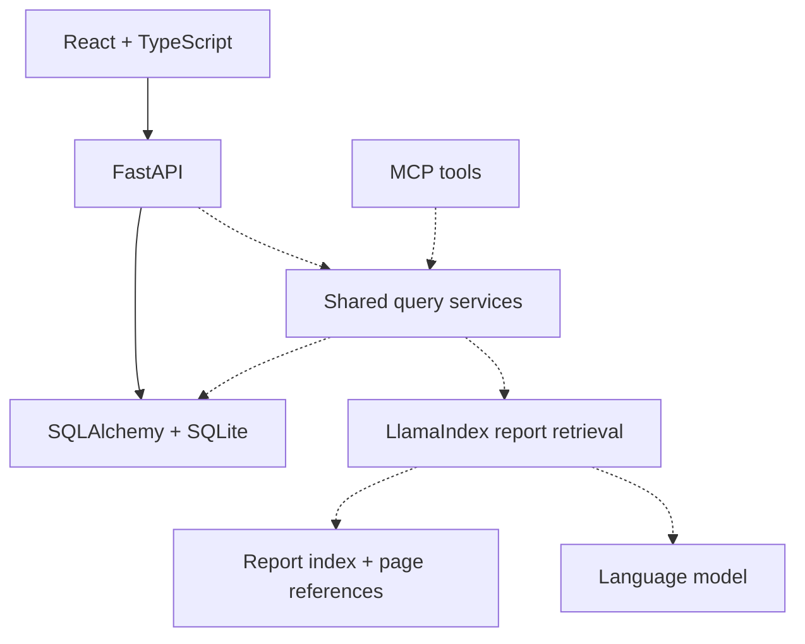

# EnergyAtlas

A full stack workspace for finding and organising public German energy sources.

EnergyAtlas is being developed into a research application that combines
source-backed energy statistics with answers grounded in public reports.

**Current version: integrated source catalogue, checkpoint 0C.**
Browse sources, filter by topic, add links and save favourites. Real report
retrieval, numerical energy-data queries and MCP tools are future improvements.

## Overview

The project connects a React interface to a Python API and a relational database.
Its first complete flow is deliberately small: save a source in the browser and
retrieve the same saved state after a refresh or application restart.

The source catalogue and the earlier LlamaIndex foundation now live in one
repository. The catalogue does not call a language model.

## Features available now

- Four curated links to original energy publishers.
- Search by source title, publisher or description.
- Topic filters and a saved-sources view.
- A form for adding source metadata with validated URLs.
- Persistent favourites stored in SQLite.
- Interactive API documentation.
- A setup diagnostic that detects incomplete project extractions.

Source search currently searches metadata, not the contents of linked pages.

## Architecture

The solid connections are implemented. Dashed connections are planned.



### Key design decisions

- **Separate interface and application logic:** React makes HTTP requests;
  FastAPI validates them and performs database operations.
- **Explicit saved state:** a bookmark request sets `saved=true` or `saved=false`.
  Repeating the same request does not toggle the result.
- **A database before AI integration:** exact structured values will be queried
  from validated tables, with units, periods and source information.
- **Shared future services:** FastAPI and MCP will reuse the same report-search
  and statistics functions.
- **Small, verifiable steps:** features are marked complete only after their
  behaviour has been checked.

## Core technologies

| Layer | Technology | Current use |
| --- | --- | --- |
| Frontend | React, TypeScript, Vite | Catalogue interface and API calls |
| Backend | Python, FastAPI, Pydantic | Validation and application routes |
| Database | SQLAlchemy, SQLite | Source metadata and favourites |
| Testing | pytest, unittest | API behaviour, setup checks and mock RAG contracts |
| Automation | GitHub Actions configuration | Checks configured; remote results reported separately |
| Report foundation | LlamaIndex | Separate model-double workflow |
| Next database | PostgreSQL | Configuration included; execution pending verification |

## How to run

### 1. Requirements

Use Python 3.12, Node.js 24 and npm for the tested dependency set.
No model download, AI API key or Docker installation is needed for the catalogue.

Extract the integrated package into a new folder, or clone the repository when
available. Open the folder containing `backend`, `frontend` and `package.json`.

### 2. Check the project

In Windows PowerShell:

```powershell
python scripts/check_setup.py
```

The diagnostic reports the Python and Node versions and checks that required
files are present. It makes no network requests and installs nothing.

If it reports missing files, re-extract the integrated package. Do not copy
individual files from older checkpoints into this folder.

### 3. Install dependencies

```powershell
python scripts/setup_local.py
```

This creates `.venv-fullstack`, installs the pinned backend dependencies and runs
`npm ci` for the frontend. It uses `python` directly and does not require the
Windows `py` launcher.

### 4. Start the application

```powershell
npm.cmd run dev
```

Open:

- Application: http://127.0.0.1:5173
- API documentation: http://127.0.0.1:8010/api/docs
- Health check: http://127.0.0.1:8010/api/health

Keep the terminal running. Press `Ctrl+C` to stop both servers.

On Linux, run the same Python setup commands and use `npm run dev`.

See [Windows instructions and troubleshooting](START_HERE_WINDOWS.md).

## Interactive walkthrough

1. Browse the four starting sources.
2. Search for `Bundesnetzagentur` to find SMARD.
3. Clear the search and choose the `Renewables` topic.
4. Save a source using its bookmark button.
5. Open Saved sources and refresh the page.
6. Add another source using its original URL and a short description.
7. Try adding the same URL again to see duplicate-source handling.

The application creates `energyatlas.db` in the project root. This file stores
local metadata and favourites and is excluded from Git.

This is currently a single-user local application. Bookmarks are shared within
its database. Authentication and separate user workspaces are not implemented.

## API reference

| Method | Endpoint | Purpose |
| --- | --- | --- |
| GET | `/api/health` | Check the API and database connection |
| GET | `/api/sources` | List and filter source metadata |
| POST | `/api/sources` | Add source metadata |
| PATCH | `/api/sources/{id}/bookmark` | Set the saved state |
| GET | `/api/overview` | Return catalogue counts |
| GET | `/api/docs` | Open interactive documentation |

Source listing accepts `q`, `topic` and `saved_only` query parameters.

Example: `GET /api/sources?q=Bundesnetzagentur&topic=Electricity`

To save source 1, send `PATCH /api/sources/1/bookmark` with:

```json
{"saved": true}
```

## Testing

### Catalogue API — Windows PowerShell

```powershell
$env:PYTHONPATH = "backend"
.\.venv-fullstack\Scripts\python.exe -m pytest backend\tests -v
Remove-Item Env:PYTHONPATH
npm.cmd --prefix frontend run build
```

The API suite checks combined filters, bookmark persistence across app restarts,
repeated bookmark requests, duplicate URLs and invalid input.

### Separate RAG foundation

The original mock workflow retains its own dependencies and environment:

```powershell
python -m venv .venv-rag
.\.venv-rag\Scripts\python.exe -m pip install -r requirements.txt -c constraints-py312.txt
.\.venv-rag\Scripts\python.exe -m unittest discover -s tests -v
.\.venv-rag\Scripts\python.exe checkpoint.py
```

The original `top_k` learner exercise is unchanged. Its guide is preserved in
[the RAG checkpoint guide](docs/RAG_CHECKPOINT.md).

See [verification](docs/verification.md) for dated results and remaining limits.
Local checks do not establish Windows, PostgreSQL or hosted CI results.

## Where LlamaIndex fits

The current web catalogue does not use LlamaIndex. The original `checkpoint.py`
and `workflow.py` use it with identical mock embeddings and a prompt-echo model.

That exercise checks how documents move through indexing, retrieval and response
synthesis. It does not measure relevance or produce real answers.

The next report service will retain document and page metadata, retrieve
supporting passages, and use a selected language model to produce cited answers.
Model selection requires a separate hardware, licence and budget decision.

## Public source links

The initial catalogue contains manually curated links to:

- [SMARD](https://www.smard.de/en)
- [Energy-Charts](https://www.energy-charts.info/)
- [Umweltbundesamt](https://www.umweltbundesamt.de/en/topics/climate-energy/renewable-energies)
- [AG Energiebilanzen](https://ag-energiebilanzen.de/en/)

The catalogue stores metadata only. It does not automatically download reports
or import these publishers' statistics. Future imports will record access/reuse
terms, source URLs, units, periods and geographic scope.

## Future improvements

- [ ] Verify the catalogue on Windows and in browser interaction tests.
- [ ] Verify PostgreSQL and introduce schema migrations.
- [ ] Import one public energy dataset through a repeatable validation pipeline.
- [ ] Add supported region, year and metric queries with units and sources.
- [ ] Display a chart based on verified imported data.
- [ ] Ingest 3–5 permitted German/English energy reports with PDF-page references.
- [ ] Add real embeddings and report answers with citations.
- [ ] Handle questions that lack sufficient supporting evidence.
- [ ] Evaluate a labelled set of 12 questions before tuning retrieval.
- [ ] Expose `search_reports` and `get_region_statistics` through MCP.
- [ ] Add authentication and deployment checks for hosted use.

Hybrid retrieval, reranking and optional maps can be evaluated after a working
baseline. Forecasting, automatic crawling and distributed sharding are outside
the first release.

## Project documentation

- [Architecture](docs/architecture.md)
- [First-release scope](docs/project_scope.md)
- [Progress and next steps](docs/PROGRESS.md)
- [Understand the code](docs/LEARN.md)
- [Contribution record](CONTRIBUTIONS.md)

## Attribution and licence

AI assistance is recorded in CONTRIBUTIONS.md. Independent implementation and
learning explanations should be recorded after the contributor completes them.

Upstream attribution remains in [THIRD_PARTY_NOTICES.md](THIRD_PARTY_NOTICES.md).
See [LICENSE](LICENSE) and the upstream notices for applicable terms.
