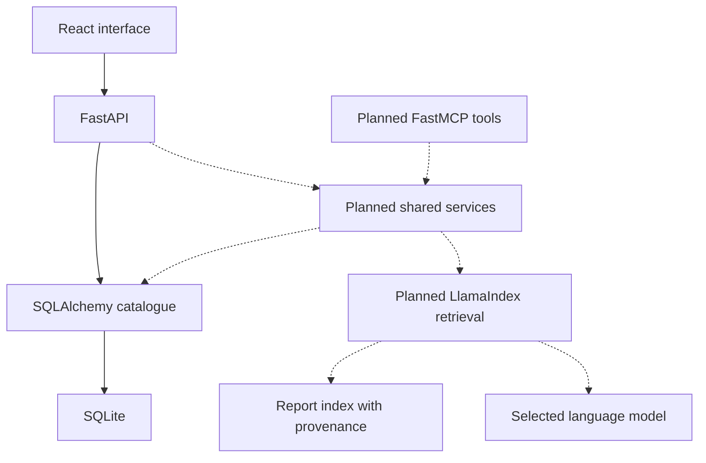

# EnergyAtlas architecture

## Current integrated checkpoint 0C

React/TypeScript calls FastAPI routes. SQLAlchemy persists source metadata and
shared bookmarks in SQLite. The original LlamaIndex mock workflow remains
independent, with a separate environment and unchanged learner exercise.

Solid paths are implemented; dashed paths are planned.

## Intended data flow

For figures, validated queries return values, units, definitions, geographic
coverage, reporting period and original source. No geographic detail is invented
when the source only supports national statistics.

For report questions, retained PDF page text is chunked and indexed with source
metadata. Retrieval selects evidence, then answer generation and citation checks
produce a supported response or an explicit insufficient-evidence outcome.

Administrative regions, grid areas and dataset coverage are separate concepts.
Use source-provided identifiers and many-to-many report/region relationships
where needed. A dataset observation need not originate from a report.

## First release boundaries

3–5 permitted text PDFs, one validated dataset, 12 labelled evaluation questions
(9 answerable, 3 unsupported), two read-only MCP tools, and the full stack app.
Measured retrieval metrics and answer/citation review remain separate.

Keep SQLite for the initial run. Verify PostgreSQL and migrations separately.
No sharding, GIS routing, forecasting, automatic crawling or model training is
needed for this release.

## Historical design

The earlier RAG-first architecture and scope are preserved in docs/archive.
The user's full stack direction changes delivery order, not the evidence needed
to declare real retrieval, MCP or deployment complete.
