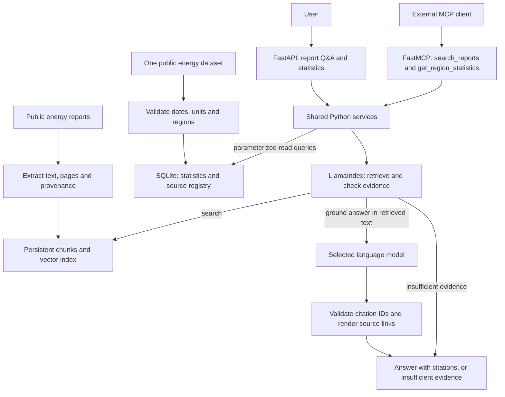

# Architecture: version 1 target

Status: a design for the intended application. Only the model-double checkpoint,
setup diagnostic and repository checks are currently implemented. The diagram
does not imply that its API, database, model integrations or MCP tools exist yet.

## Decisions

| Component | Initial choice | Reason |
| --- | --- | --- |
| Language | Python; Python 3.12 is the tested checkpoint target | Matches the learning and target-job goals |
| RAG orchestration | LlamaIndex Workflow | Retains the inspected reference; one approach to learn |
| Vector storage | LlamaIndex's local persisted index | A small collection needs no separate vector-database service initially |
| Statistics/source registry | SQLite via Python's standard library | Allows SQL practice without running another server |
| Models | Pending Windows hardware, language, licence and budget checks | Generation and embedding choices have separate constraints |
| MCP | FastMCP, introduced in milestone 4 | Both tools will call the same tested services as the API |
| Interface | FastAPI, introduced in milestone 5 | A small inspectable application and API contract |
| Checks | unittest; GitHub Actions on Ubuntu and Windows/Python 3.12 | Keep dependencies small and test the user's intended platform |

## Source and citation contract

For each report retain an internal ID, title, publisher, source URL, publication
date if known, retrieval timestamp, file hash, and reuse/licence notes. An unknown
publication date stays unknown; the download date is not a substitute.

Extract pages separately. Each chunk retains the report ID and physical PDF page
number, counted from 1. Distinguish a printed page label if one is available.
Resolve citation links and titles from the registry; do not trust model-generated
URLs. Validate referenced IDs against the retrieved passages. A valid source ID
alone does not prove that a sentence is supported: include citation-support review
in the initial evaluation.

For statistics retain the region definition, year, metric definition, value, unit,
source URL and dataset version/date. Use the source's actual grain. Unsupported
combinations return unavailable; the LLM does not fill missing data. The selected
dataset and its concrete schema will be recorded after source verification.

## Application boundaries

The report service retrieves passages and constructs the grounded prompt. The
statistics service executes parameterized queries against validated tables.
The API and MCP adapters call those shared services. They do not implement their
own ingestion or duplicate business logic. Numerical database results do not need
to pass through an LLM to be accurate.

For version 1, users choose report-Q&A or statistics explicitly. There is no need
for a second agent/orchestration framework or an autonomous SQL-generating agent.
Public-document text is untrusted content, not application instructions.

## Current checkpoint data flow

`checkpoint.py` supplies `MockLLM` and `MockEmbedding` to `workflow.py`. The workflow
loads `data/demo/*.txt`, builds an in-memory index, retrieves up to `top_k` nodes
and passes those nodes into synthesis. The vectors are identical and the model
echoes a prompt. This establishes connectivity, not ranking or answer quality.

The user can write the one-line `top_k` exercise independently. The mentor-written
repository/diagnostic work does not count as that learner change.
