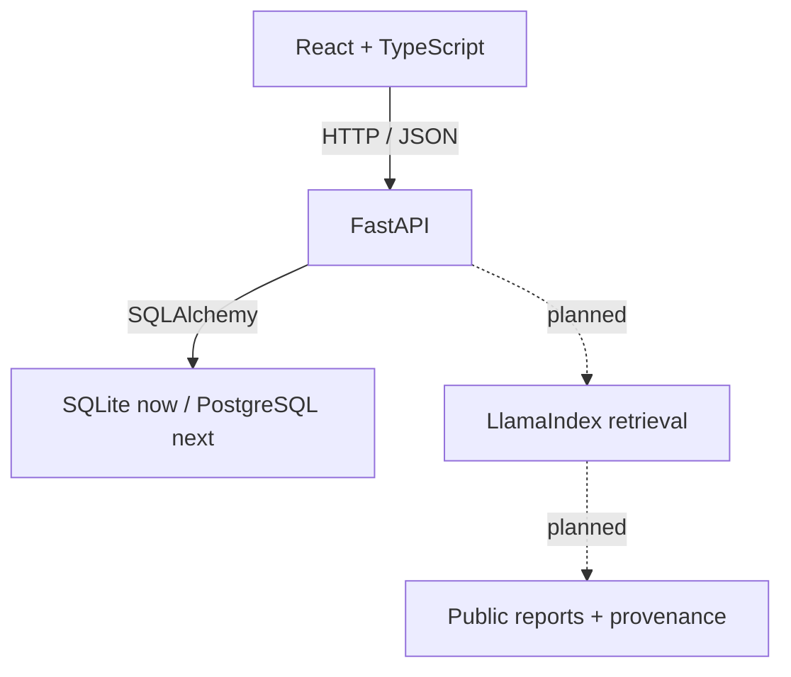

# Full stack architecture — checkpoint 0B

Decision: 16 November 2026. Extend EnergyAtlas with React/TypeScript, retain
Python/FastAPI, and use SQLAlchemy so the SQLite quickstart can progress to
PostgreSQL. This is a learning and portfolio application.

The solid path is implemented. Dashed connections are planned and are not called
by the UI. The original checkpoint 0A mock workflow remains separate.
The user's request to start full stack foundations updates the earlier RAG-first
milestone order; it does not establish that any RAG milestone passed.

## One request, explained

1. Clicking a bookmark calls `saveSource` in `frontend/src/api.ts`.
2. `fetch` sends PATCH `/api/sources/1/bookmark` with `{"saved": true}`.
3. FastAPI validates the path and JSON, then opens a database session.
4. SQLAlchemy loads the source, updates its saved state and commits.
5. The API returns the updated source. React reloads the list and counters.

Setting an explicit state is idempotent: repeating `saved: true` does not toggle
the bookmark back off. A test checks this and persistence across app restarts.

## Implemented API

| Method | Path | Purpose |
| --- | --- | --- |
| GET | /api/health | Check API and database connection |
| GET | /api/sources | List, search metadata, filter topic/saved state |
| POST | /api/sources | Validate and add source metadata |
| PATCH | /api/sources/{id}/bookmark | Set an explicit bookmark state |
| GET | /api/overview | Count sources, publishers and bookmarks |
| GET | /api/docs | Interactive API reference |

Search matches title, publisher and description. It is not semantic search and
does not download or search source contents. Added URLs are stored as metadata;
the backend does not fetch arbitrary URLs.

## Data model

`sources`: id, title, publisher, description, url (unique), topic, kind, saved.
Bookmarks are shared within this local database. There are no accounts or
per-user permissions yet. Run one development API worker for seeding.
`create_all` establishes the initial schema; it is not a migration system.

## Incremental plan

| Checkpoint | Deliverable | What the learner should explain |
| --- | --- | --- |
| 0B | Source catalogue, filter, add, bookmark | Component → API → database → response |
| 0C | PostgreSQL verified locally, migrations, edit source | Constraints, transactions, schema changes |
| 0D | One real energy dataset and a chart with units/source/date | Ingestion, idempotency, aggregation |
| 1 | Real-model retrieval after hardware/budget choice | Embeddings, retrieval, generation |
| 2 | Public PDFs, page-level citations, abstention, evaluations | What supports an answer; failure cases |
| 3 | Authentication, deployment and end-to-end regression tests | Access control and application operation |
| 4 | MCP tools over bounded read-only operations | Tool contracts and data access |

The learner's independent `top_k` exercise from checkpoint 0A is untouched.
Learning notes are the learner's work; AI-generated code is recorded separately.
No paid model or ChatGPT plugin is needed for checkpoint 0B. GitHub connectivity
is useful only if direct repository creation/pushing is wanted.

## Scope limits

- Local single-user application; no public deployment or GitHub push has happened.
- PostgreSQL configuration is included, but requires verification before claiming
  PostgreSQL end-to-end operation.
- No files are uploaded, no PDFs are ingested, no LLM is called, no MCP server runs.
- External links do not confer redistribution permission for source content.
- SQLite tests do not establish PostgreSQL, Docker or Windows compatibility.

## Primary references

- https://react.dev/learn
- https://vite.dev/guide/
- https://fastapi.tiangolo.com/tutorial/sql-databases/
- https://docs.sqlalchemy.org/en/20/orm/quickstart.html
- https://www.smard.de/en
- https://www.energy-charts.info/
- https://www.umweltbundesamt.de/en/topics/climate-energy/renewable-energies
- https://ag-energiebilanzen.de/en/
